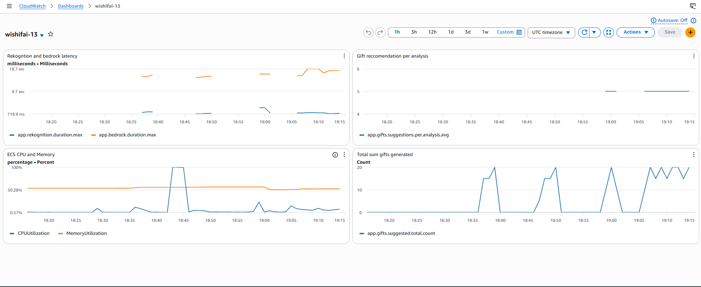
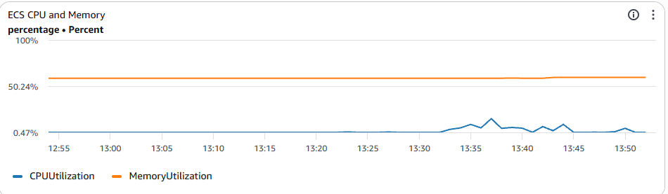
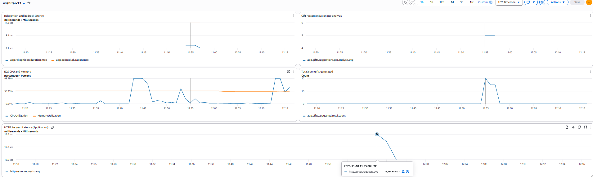
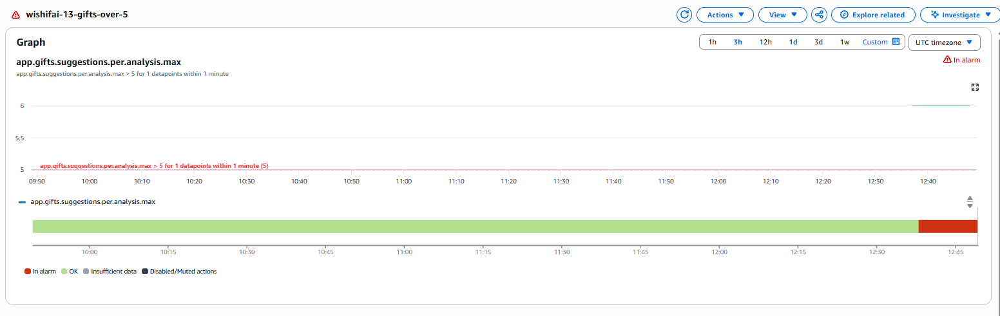
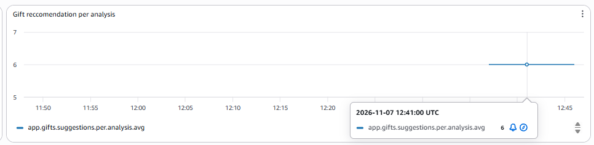

# exam-devops-2026

# Oppgave 1a
```bash
docker build -t wishifai .
docker run -p 9999:8080 -e AWS_ACCESS_KEY_ID -e AWS_SECRET_ACCESS_KEY -e AWS_REGION=eu-west-1 -e S3_BUCKET=wishifai-images-13 wishifai
```

# Oppgave 1b
Tagging-strategi:
Hvert image tagges med kort commit-SHA og latest. SHA-taggen gjør det mulig å spore nøyaktig hvilken commit som kjører i ECS, og å rulle tilbake til en tidligere versjon. latest peker alltid på siste bygg og er praktisk for lokal testing.

PS:
Underveis senere i oppgaven oppdaget jeg at ECS ikke plukket opp nytt image ved push, til tross
for at både commit-SHA og latest ble pushet til ECR. Årsaken var at Terraform
ikke sendte SHA-taggen videre til task definition. Løst ved å sende commit-SHA
eksplisitt som Terraform-variabel slik at task definition endres ved hver deploy.
Lenken under er derfor fra en kjøring etter denne rettelsen, og viser den endelige workflowen.
## Lenke til grønn kjøring: https://github.com/Shaygan94/exam-devops-2026/actions/runs/42371750609

# Oppgave 2a
 ## Offentlig URL til tjenesten: https://wi-40b646c1b32242618c04acfba1c6bc89.ecs.eu-west-1.on.aws

# Oppgave 2b
Terraform state lagres i S3 med nøkkel: wishifai/13/terraform.tfstate. Dette gjøres i backend.tf 
Backend-konfigurasjon i Terraform støtter ikke variabler og derfor hardkodet jeg appnavn og kandidatnr. 

# Oppgave 2c
Det er fornufting at terraform kjører etter at containeren er builda, fordi infrastrukturen trenger den nye Docker-imagetaggen for å vite hvilken versjon av applikasjonen som skal deployes til ECS. Hvis terraform hadde kjørt før eller parallelt, ville ikke imaget eksistert enda. 

## Lenke til grønn kjøring: https://github.com/Shaygan94/exam-devops-2026/actions/runs/41517134852

# Oppgave 3a

Tekniske-metrikker
- app.rekognition.duration måler responstid for rekognition-kallet 
- app.bedrock.duration måler responstid for Bedrock-kallet

Business-metrikker
- app.gifts.suggested.total (counter). Totalt antall giftforslag generert. Sier noe om faktisk bruksvolum (ikke bare antall kall).

- app.gifts.suggestions.per.analysis (distributionsummary). Antall forslag per analyse. i AI prompten er det "inntil 5" i en tekstinstruksjon uten en hard grense. Metrikken vil avdekke om AI'en faktisk følger dette. Dette kan vil jeg bruke som grunnlag for alarmen i 3B.

# Oppgave 3b

Dashboard heter `wishifai-13`
Datagrunnlaget er 40 curl-kall mot tjenesten (20 per bilde).

Dashboardet dekker de tre kategoriene oppgaven krever: Business (gaver per analyse og totalt antall gaver), Infrastruktur (ECS CPU og minne) og Applikasjon (HTTP request-latency fra Spring Boot Actuator).



## Rekognition and Bedrock latency
Viser maksimal responstid per min. Bedrock bruker ca 16-19 sek og Rekognition bruker under 1 sek. Bedrock er den klare flaskehalsen og forklarer grunderens bekymring om treg tjeneste. 

## Gift reccomondation per analysis
Viser gjennomsnittlig gaveforslag returnert per analyse. Prompten instruerer Bedrock om "inntil 5 gaver", og grafen bekrefter at modellen returnerer nøyaktig 5. 

## ECS CPU and Memory
Viser maksimal CPU og minnebruk for ECS-tjenesten. Memory ligger stabilt på 50% gjennom hele perioden. CPU viste en spike til 100% som virket uventet for Rekognition- og Bedrock-kall. For å undersøke kjørte jeg en ny test med 40 curl-kall uten deployment, og da holdt CPU seg lav og jevn gjennom hele testen. Dette bekrefter at spiken skyldtes redeployment, ikke Rekognition- og Bedrock-kallene.
Bildet under illustrerer CPU/Memory ved 40 curl-kall uten redeployment prosessen:

Det er greit å ha dette i bakhodet når man skal feks ha alarmer mot cpu bruk - å ta i betrakning at deployments vil bruke mye cpu, slik at alarmer ikke utløses på det. 

## Total sum gifts genereated
Viser totalt antall gavefroslag generert. Gir innsikt i bruksvolum og aktivitetsmønstre over tid. 

## HTTP Request Latency
Viser responstid for POST /api/analyze, hentet fra Spring Boot Actuator via Micrometer. Gjennomsnittet ligger på rundt 18,5 sekunder per kall. Det stemmer med summen av Bedrock (16–19 sek) og Rekognition (under 1 sek), og bekrefter at nesten all ventetid for brukeren skyldes Bedrock.


## Alarm
`wishifai-13-gifts-over-5` varsler hvis Bedrock returnerer flere enn 5
gaveforslag i en analyse. Prompten sier "inntil 5", men siden dette er en
tekstinstruksjon uten hard kode-grense ønsket jeg å verifisere at alarmen
fungerte som forventet.

Første test bekreftet at modellen konsekvent returnerte nøyaktig 5 forslag
og alarmen forble grønn. For å utløse alarmen endret jeg prompten til
"inntil 6 gaver". Bedrock fulgte instruksjonen og returnerte nøyaktig 6 forslag,
og alarmen gikk av som forventet.



# Oppgave 4 

## Kontinuerlig leveranse og testing

Fordi en AI kan gi ulike svar på samme input, kan man ikke teste mot ett fasitsvar slik man gjør med vanlig kode. Man må i stedet teste egenskaper ved svaret, for eksempel at det gis maks 5 forslag. Alarmen min sjekker nettopp dette, men først i produksjon, etter at brukeren har fått svaret. Den samme sjekken kunne kjørt på et fast sett med testbilder i pipelinen, slik at feilen ble oppdaget før deploy.

I Wishifai ligger prompten i BedrockService.java, så kode, prompt og modell deployes samlet i ett image tagget med commit-SHA. Fordelen er at prompten versjoneres i git og kan rulles tilbake ved å deploye forrige tag. Ulempen er at selv ett ord krever full redeploy, og at endringen går til alle brukerne på en gang.

Det finnes flere måter å begrense dette på. Med en feature flag kan en ny prompt slås av og på uten ny deploy. Med canary går en ny versjon først til en liten andel av brukerne, og andelen økes gradvis hvis metrikkene ser normale ut. Med A/B-testing kjører to promptvarianter parallelt, og man måler hvilken som gir best resultat.

For Wishifai ville en feature flag vært et naturlig første steg, fordi den lar meg slå en ny prompt av og på uten full redeploy. Flaggen kan også dele trafikken mellom to promptvarianter, slik at den fungerer som en A/B-test målt med gifts.suggestions.per.analysis. Canary passer bedre der en feil prompt kan gjøre skade, fordi færre brukere rammes før feilen oppdages.

## Overvåking og menneske i loopen
Automatisering holder når kravet kan måles. Alarmen min fanger mer enn 5 gaver uten at noen ser på svarene, men den sier ingenting om hvorvidt gavene passer. Et barnerom kan gi fem forslag og grønn alarm, selv om ett er upassende for barn. Det krever stikkprøver lest av et menneske.

Prompten bør også reviewes. Modellen returnerte alltid nøyaktig 5 ved “inntil 5” og nøyaktig 6 ved “inntil 6”, så den tolket “inntil” som et krav og ikke som en grense. Siden pipelinen deployer direkte ved push til main, bør prompt- og modellendringer gå via en godkjent pull request.

## Risiko og ansvar
Hvor mye kontroll man trenger før produksjon, avhenger av hva en feil koster. Som nevnt oppdager alarmen min feil først i produksjon. Det er greit i Wishifai, for et gaveforslag som bommer, gjør ingen skade, og neste forslag kan bli bedre.

Ved juridisk rådgivning er situasjonen en helt annen. Hvis modellen gir feil svar om en frist, kan personen miste en rettighet før noen alarm rekker å gå. Da hjelper det ikke at feilen oppdages i etterkant. Før en ny prompt eller modell tas i bruk, bør den derfor gjennom en gate i pipelinen der den testes mot kjente saker med fasit, og en jurist bør godkjenne resultatet. I medisinsk rådgivning bør en lege se over hvert svar før pasienten får det.

Skillet går mellom feil som kan rettes og feil som ikke kan det. Feil man kan rette, kan oppdages i produksjon. Feil som ikke kan rettes, må stoppes før de når brukeren.


